<div align="center">

<p>
  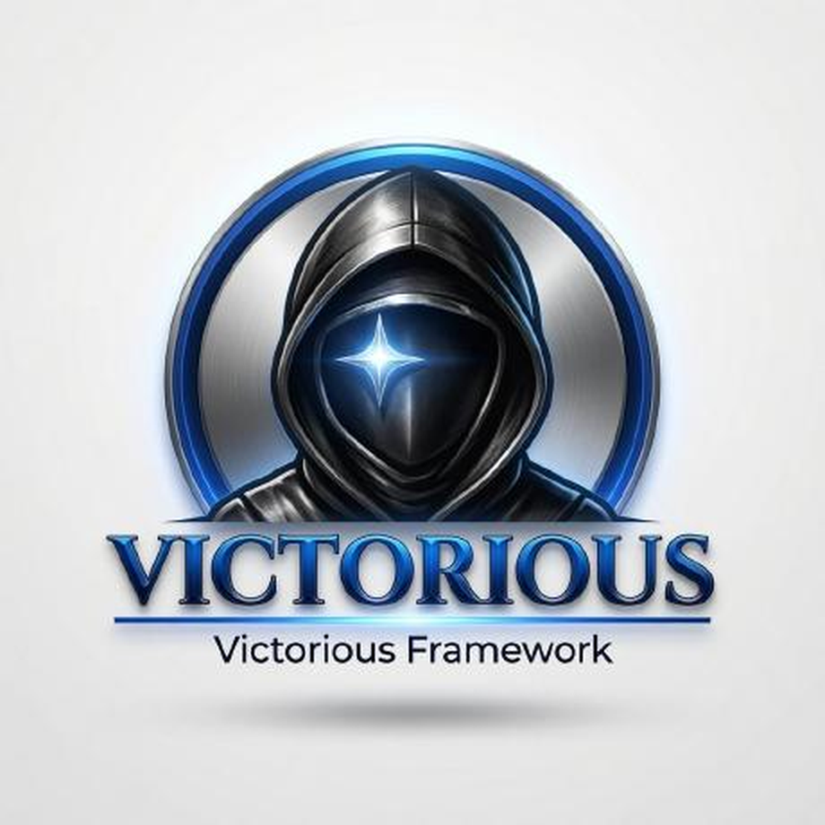
</p>

# Victorious Fleet

**Monorepo of all Victorious Framework apps** — each `apps/<name>` is a git submodule (or a stub) pointing at the live repo.

<p>
  <a href="https://victorious-framework.pages.dev"></a>
  <a href="https://www.instagram.com/sudo.victorious00"></a>
  <a href="https://github.com/Victorious93"></a>
</p>

Separate apps. One controller. Shared fleet standards.

</div>

## Overview

This repository is the **index** for Don Victor’s Victorious fleet. It does not vendor app source; it records canonical submodule URLs so agents and humans can clone the whole set (where access allows).

| Role | Detail |
|:--|:--|
| **Controller** | [droidcommand-AI](https://github.com/Victorious93/droidcommand-AI) |
| **Status / feed** | [fleet-manifest](https://github.com/Victorious93/fleet-manifest) (`ROADMAP.md`, `fleet-manifest.json`) |
| **Profile roster** | [Victorious93/Victorious93](https://github.com/Victorious93/Victorious93) |
| **Site** | [victorious-framework.pages.dev](https://victorious-framework.pages.dev) |

> Status labels below are taken from [fleet-manifest/ROADMAP.md](https://github.com/Victorious93/fleet-manifest/blob/main/ROADMAP.md) (synced Oct 27, 2026). Package IDs prefer **build.gradle(.kts) `applicationId`** when present.

## Apps

| | App | Package id | Status | Type |
|:-:|:--|:--|:--|:--|
| 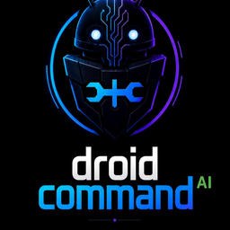 | [droidcommand-AI](https://github.com/Victorious93/droidcommand-AI) | `ai.droidcommand.app` | CI green / awaiting device test | submodule |
|  | [HackerAI-Commander](https://github.com/Victorious93/HackerAI-Commander) | `ai.hackerai.companion` | CI green | submodule |
| 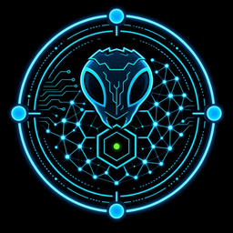 | [Pentest-Swarm-AI](https://github.com/Victorious93/Pentest-Swarm-AI) | `ai.pentestswarm.companion` | CI green [Likely] | submodule |
| 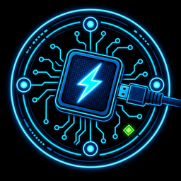 | [EDL-Commander](https://github.com/Victorious93/EDL-Commander) | `ai.edlcommander.companion` | scaffold / CI | submodule |
| 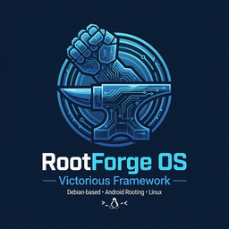 | [rootforge-os](https://github.com/Victorious93/rootforge-os) | `ai.rootforge.os` | CI green | submodule |
| 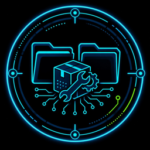 | [File-Manager](https://github.com/Victorious93/File-Manager) | `ai.victorious.filemanager` | CI green (rename landed) | submodule |
|  | [Victorious-Keyboard](https://github.com/Victorious93/Victorious-Keyboard) | `com.victorious.keyboard` | CI green / merging | submodule |
| 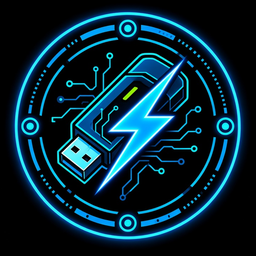 | [victorious-flash](https://github.com/Victorious93/victorious-flash) | `com.victorious.flash.android` | CI green (desktop) | submodule |
|  | [victorious-mesh](https://github.com/Victorious93/victorious-mesh) | `com.victorious.mesh` | CI green | submodule |
|  | [victorious-browser](https://github.com/Victorious93/victorious-browser) | `com.victorious.browser` | CI green | submodule |
|  | [victorsms](https://github.com/Victorious93/victorsms) | `com.victorious.sms` | CI green / feature-rich (not device-tested) | submodule |
| 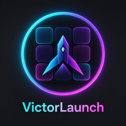 | [victorlaunch](https://github.com/Victorious93/victorlaunch) | `com.victorious.launch` | CI green | submodule |
|  | [victorspoof](https://github.com/Victorious93/victorspoof) | `com.victorious.spoof` | scaffold | submodule |
|  | [VictorLink64](https://github.com/Victorious93/VictorLink64) | `org.victoriousframework.victorlink64` | early beta / public | submodule |
|  | [VictorSuite](https://github.com/Victorious93/VictorSuite) | `com.termux` | CI green / not device-tested | submodule |
|  | [KYC-AuditLab](https://github.com/Victorious93/KYC-AuditLab) | `com.identityshield.companion` | blocked (policy hold) | submodule |
| 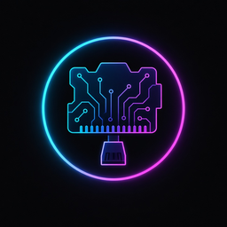 | [BakerPi-Installer](https://github.com/Victorious93/BakerPi-Installer) | n/a (host tool) | CI green | submodule |
|  | [fleet-manifest](https://github.com/Victorious93/fleet-manifest) | n/a (manifest) | docs / feed | submodule |
|  | [matchvictorious](https://github.com/Victorious93/matchvictorious) | `com.victorious.match` | scaffold / planning | submodule |
| 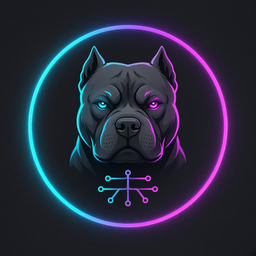 | VictoryPed 🔒 | `com.victorious.victoryped` | scaffold / planning | submodule |
|  | victormodem 🔒 | hardware (no pkg yet) | planning / scaffold | submodule |
| 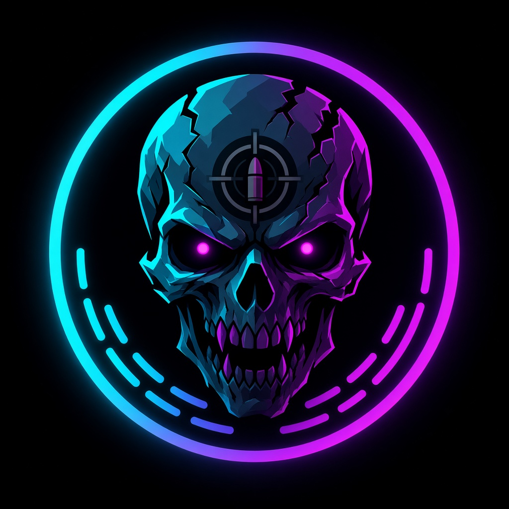 | [victorops-zombies](https://github.com/Victorious93/victorops-zombies) | `com.victorious.zombie` | scaffold (playable slice; now **public**) | submodule |
| 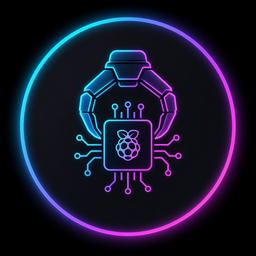 | [pyra-claw](https://github.com/Victorious93/pyra-claw) | `com.victorious.pyraclaw` *(companion)* | planning / scaffold | submodule |
|  | [victorcam](https://github.com/Victorious93/victorcam) | `com.victorious.cam` | scaffold (OBS-style virtual cam) | submodule |
| | [victormango](https://github.com/Victorious93/victormango) | `com.victorious.mango` | scaffold (GL.iNet Mango companion; RPC auth real, features stubbed) | submodule |
| | [victortaskbar](https://github.com/Victorious93/victortaskbar) | `com.victorious.taskbar` | MVP scaffold with official logo (desktop-style taskbar) | submodule |
| | victortrade 🔒 | `com.victorious.trade` | scaffold / planning (initial commit) — crypto-bots hub: exchange APIs + self-hosted + on-chain | submodule |

🔒 = private repo (submodule URL recorded; clone needs access). VictoryPed, victormodem, and victortrade are private; victorops-zombies is now public.
VictorTrade (private 🔒), VictorMango, and VictorTaskbar were added as submodules on Oct 27.

## Structure

```text
victorious-fleet/
├── README.md
├── .gitmodules
├── assets/logos/          # fleet app logos (this PR)
└── apps/
    ├── droidcommand-AI/   # submodule → Victorious93/droidcommand-AI
    ├── …
    ├── VictorCam/         # submodule on main (victorcam)
    ├── VictorMango/       # submodule (victormango)
    ├── VictorTaskbar/     # submodule (victortaskbar)
    ├── VictorTrade/       # submodule (victortrade, private)
    ├── …
```

`.gitmodules` is the source of truth for submodule paths and URLs.

## Clone / update

```bash
git clone --recurse-submodules https://github.com/Victorious93/victorious-fleet.git
# or after a plain clone:
git submodule update --init --recursive
```

Submodules that point at **private** repos will not clone without access. That is expected — the pointer still records the canonical URL.

There is **no root Gradle/Cargo workspace** here. Build each app inside its own submodule using that repo’s documented entrypoints (`./gradlew`, Python `requirements.txt`, etc.).

## Related

- Fleet site: https://victorious-framework.pages.dev  
- Instagram: https://www.instagram.com/sudo.victorious00  
- Status roadmap: https://github.com/Victorious93/fleet-manifest/blob/main/ROADMAP.md  
